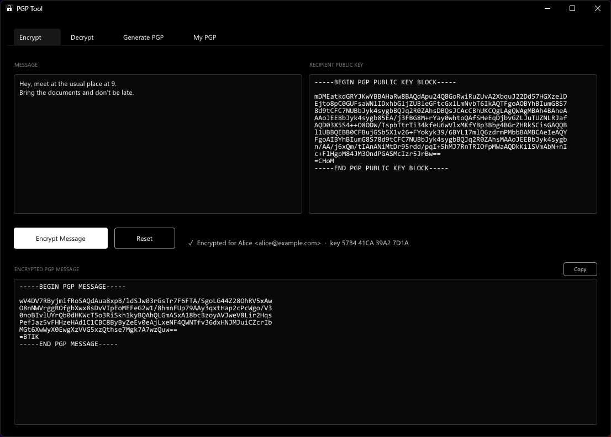
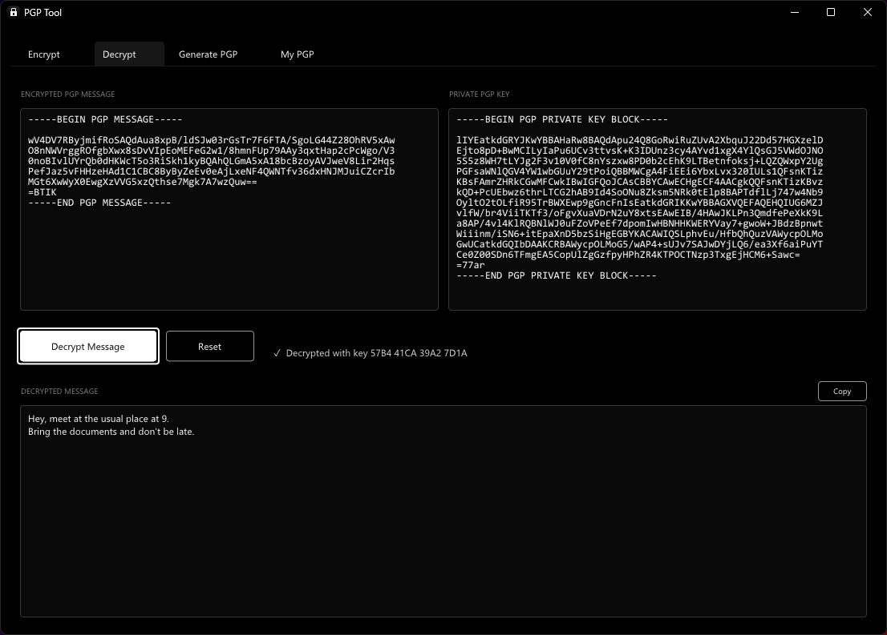
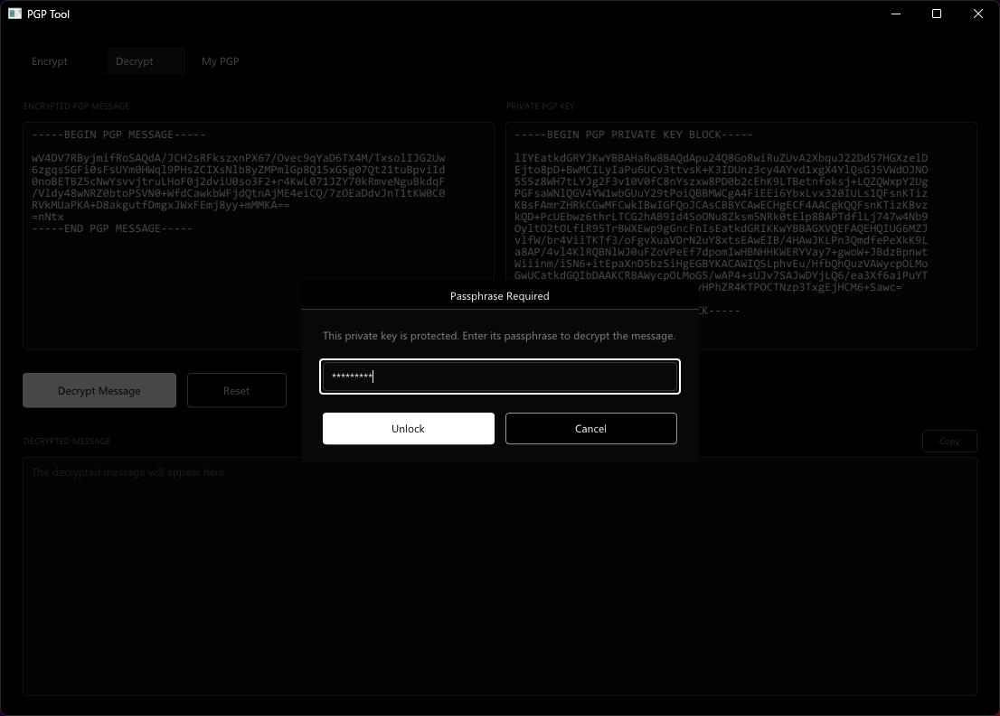
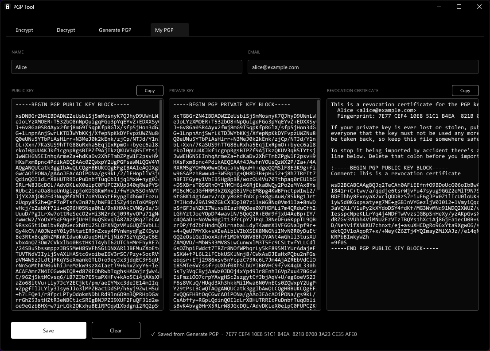
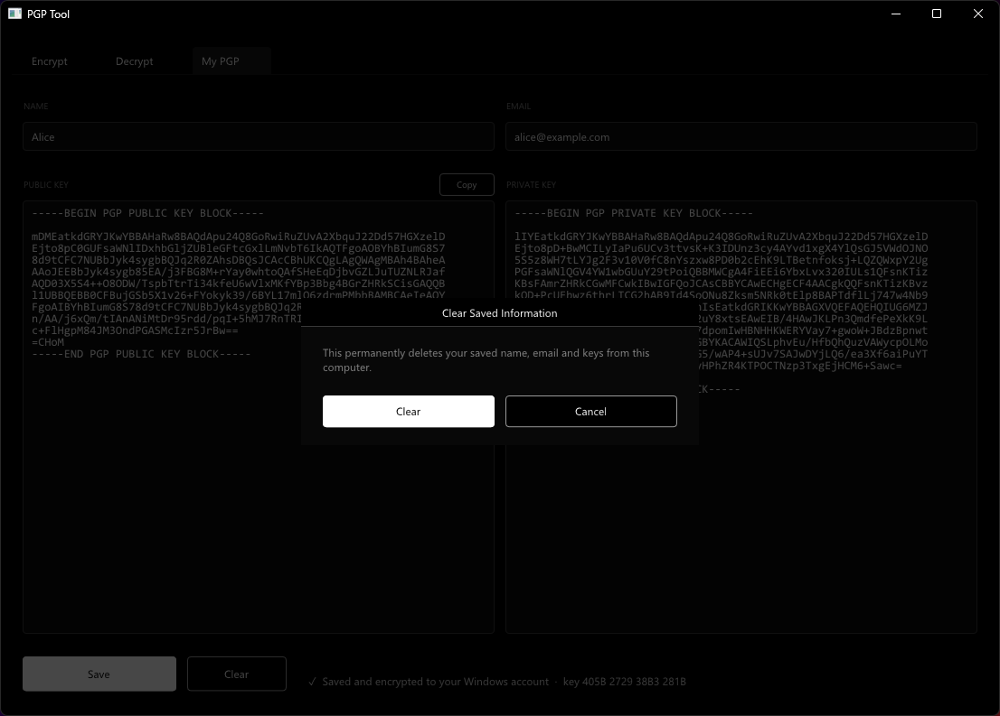

# PGP Tool

a small black and white windows app for encrypting and decrypting PGP messages. paste a key, paste a message, hit the button. that's it.

no gpg install, no kleopatra, no 400 menu options. it's one exe.



---

## what it does

**Encrypt** – type your message, paste the other person's public key, hit Encrypt Message. you get the `-----BEGIN PGP MESSAGE-----` block, hit Copy and send it however you want.

**Decrypt** – paste the encrypted message, paste your private key, hit Decrypt Message. if your key has a passphrase (it should) a little popup asks for it.





**My PGP** – save your name, email and keys so you don't have to paste your private key every single time. once it's saved, a **Use Saved Key** button shows up on the Decrypt tab.



clear asks first, because it actually deletes stuff:



---


## where does my saved stuff go?

not in a file. there's no `.txt` or `.json` sitting next to the exe.

it gets encrypted with windows DPAPI (the same thing windows uses for saved wifi passwords and browser logins) and stored in the registry under:

```
HKEY_CURRENT_USER\Software\PGPTool  ->  Profile
```

DPAPI ties it to your windows login, so another user account on the same pc can't read it, and copying the registry value to another pc gets you nothing. hit **Clear** in the My PGP tab and it's gone.

your passphrase is **never** saved. that's on purpose, the passphrase is the thing protecting the private key, saving it right next to the key would kinda defeat the point.

---


## what works and what doesn't

tested against GnuPG 2.4.9 both ways (gpg encrypts → this decrypts, this encrypts → gpg decrypts).


| thing                                                | works?                              |
| ---------------------------------------------------- | ----------------------------------- |
| RSA keys                                             | ✅                                   |
| Curve25519 keys (gpg's default since 2.3)            | ✅                                   |
| passphrase protected keys (AES, gpg's normal export) | ✅                                   |
| unprotected keys                                     | ✅                                   |
| gpg's OCB / AEAD messages                            | ✅                                   |
| ZIP / ZLIB compressed messages                       | ✅                                   |
| signed + encrypted messages                          | ✅ decrypts, signature isn't checked |
| hidden recipient (`--throw-keyids`)                  | ✅                                   |
| keys exported with `--export-secret-subkeys`         | ✅                                   |
| pasting armor out of an email with junk around it    | ✅                                   |
| BZip2 compressed messages                            | ❌ clear error                       |
| Elgamal / DSA keys (old gpg 1.x stuff)               | ❌ clear error                       |
| NIST / Brainpool ECC keys                            | ❌ clear error                       |
| v6 keys / RFC 9580 new format                        | ❌ clear error                       |
| keys protected with CAST5 / 3DES (really old gpg)    | ❌ clear error                       |


messages this app creates are AES-256 with an integrity check (SEIPD v1), which pretty much everything can read.

---


## building it

you need visual studio 2026 (v145 toolset) with the **desktop development with C++** workload. on visual studio 2022, right click the projects → retarget to v143 and it should be fine.

1. open `PGPTool.sln`
2. pick `Release | x64`
3. build

exe ends up in `Source\Bin\Release\PGPTool.exe`. release builds use the static runtime so you can just copy the exe to another pc, no redistributable needed.

no packages to install, imgui is already in `Source/Vendor/ImGui`, and everything crypto goes through windows' own bcrypt.

---


## how the code is laid out

```
PGPTool.sln
Source/
  App/            window, UI, the saved profile stuff
  Crypto/         all the OpenPGP stuff, no UI code in here
  Resources/      app icon + version info
  Vendor/ImGui/   dear imgui, untouched
  Docs/           screenshots for this readme
```

if you're poking around:

- `Crypto/OpenPgp.cpp` is the big one. packet parsing, keys, encrypt/decrypt all live there. `EncryptMessage` and `DecryptMessage` at the bottom are where the buttons end up.
- `Crypto/Primitives.cpp` is the windows bcrypt wrapper (AES, SHA, RSA, random).
- `Crypto/Curve25519.cpp` is the x25519 math (tweetnacl port).
- `Crypto/Inflate.cpp` unzips gpg's compressed messages.
- `App/Application.cpp` is every bit of UI.
- `App/ProfileStore.cpp` is the DPAPI + registry saving.

the comments in the code point at each other with line numbers if you want to follow something through.

---

## credits

- [Dear ImGui](https://github.com/ocornut/imgui) for the UI (MIT)
- the curve25519 code is based on [TweetNaCl](https://tweetnacl.cr.yp.to/) (public domain)
- the inflate code uses the same huffman decoding approach as zlib's `puff.c`

---

## license

free for non-commercial use under the [PolyForm Noncommercial License 1.0.0](LICENSE.txt).

basically:

- ✅ personal use, hobby projects, studying it, messing around with it
- ✅ schools, charities, research, non-profits
- ✅ changing it and sharing your changes, as long as the license comes with it
- ❌ using it to make money or inside a business. want to do that? ask me first

this is "source available", not technically "open source", because open source licenses have to allow commercial use.

Dear ImGui in `Source/Vendor/ImGui` isn't covered by this, it keeps its own MIT license.

